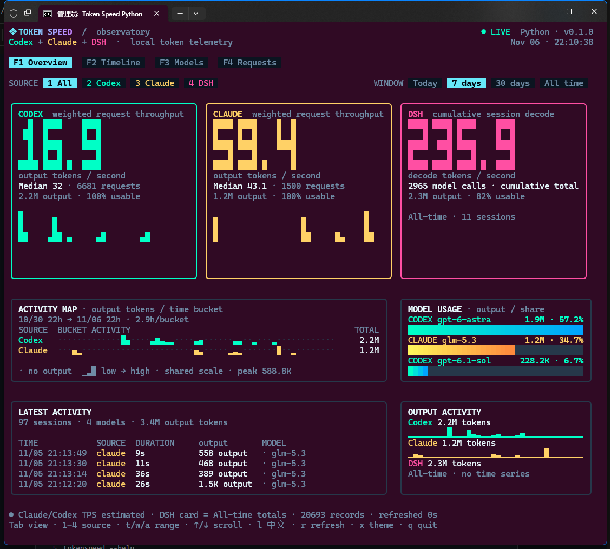
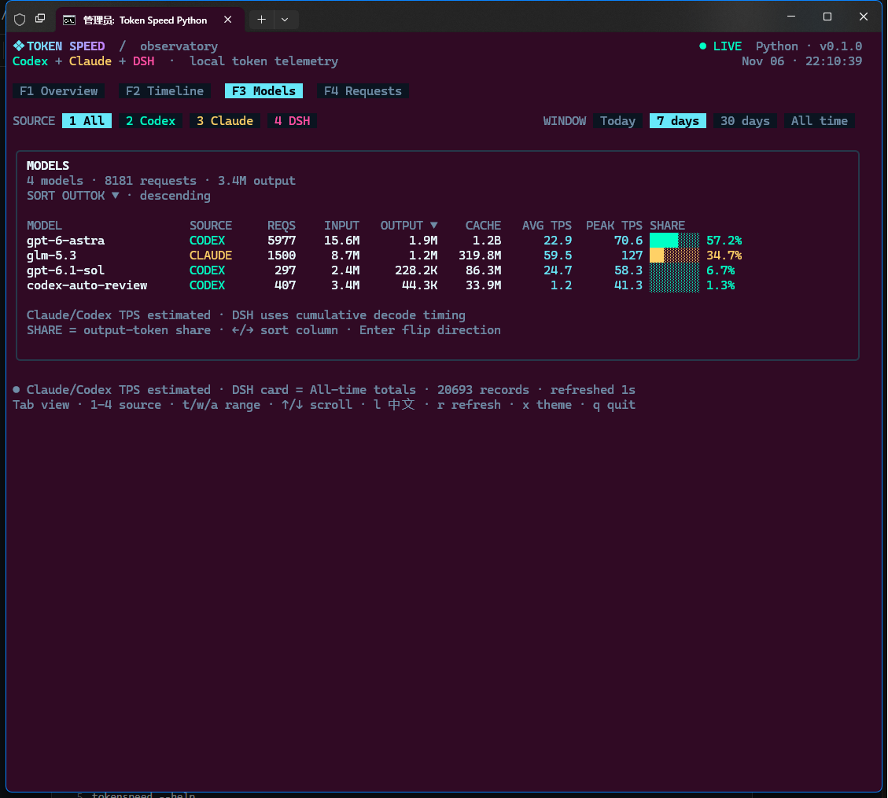

<div align="center">

# ⚡ Token Speed

**Local-first token telemetry for Claude Code, Codex and DSH.**
A colorful, keyboard-driven terminal dashboard for output usage and throughput.

**[English](README.md) · [简体中文](README.zh-CN.md)**

[](https://github.com/Etshanyu/tokenspeed/actions/workflows/ci.yml)
[](LICENSE)
[](python/tokenspeed)
[](package.json)
[](#-quick-start)

</div>

---

## ✨ Why Token Speed?

Token Speed reads the telemetry already on your machine and turns it into an interactive terminal observatory. No account, API key, background service or data upload is required.

| Icon | Feature | What you get |
| :-: | --- | --- |
| 🔒 | **Local-first** | Read-only log parsing; prompts and source code are not intentionally collected. |
| 📊 | **Four views** | Overview, Timeline, Models and Requests. |
| 🧭 | **Three sources** | Claude Code, Codex and DSH, automatically discovered. |
| 🔄 | **Live refresh** | Incremental background scans keep the interface responsive. |
| 🌐 | **English / 中文** | Press `L` to switch; UI preferences are remembered. |
| 🎨 | **Terminal-native** | Solid digits, activity maps, gradients and subtle visual effects. |

> [!NOTE]
> Token Speed is an independent, unofficial project. Claude, Codex and DSH names belong to their respective owners.

## 🖥️ Screenshots

Real captures of the Python runtime. All values come from local telemetry.



<details>
<summary><strong>View model statistics</strong></summary>
<br>



</details>

## 🚀 Quick start

### Python runtime — recommended

**Requirements:** Python 3.10+, a Unicode true-color terminal, and preferably a 120 × 50 window.

#### Windows — one-click launcher

Clone or download the repository, then double-click:

```text
run-tokenspeed-python.bat
```

The launcher creates `.venv` on first run and stores its local cache in `.tokenspeed-cache`. To enable compressed Codex archive support, run:

```powershell
.venv\Scripts\python.exe -m pip install -r python\requirements.txt
```

#### Windows — manual start

```powershell
git clone https://github.com/Etshanyu/tokenspeed.git
cd tokenspeed
py -3 -m venv .venv
.venv\Scripts\python.exe -m pip install -r python\requirements.txt
$env:PYTHONPATH = "python"
.venv\Scripts\python.exe -m tokenspeed
```

#### macOS / Linux

```bash
git clone https://github.com/Etshanyu/tokenspeed.git
cd tokenspeed
python3 -m venv .venv
.venv/bin/python -m pip install -r python/requirements.txt
PYTHONPATH=python .venv/bin/python -m tokenspeed
```

`zstandard` is optional but recommended for reading `.jsonl.zst` Codex archives. The remaining Python runtime uses the standard library.

### Node.js runtime — alternative

**Requirements:** Node.js 20 or newer.

```bash
npm install -g tokenspeed
tokenspeed
```

Or run this repository directly:

```bash
npm ci
npm start
```

Windows users can also use `run-tokenspeed.bat`.

## 🧭 Command line

The Python examples below assume `PYTHONPATH=python` from the repository root. The installed Node.js CLI uses `tokenspeed` directly.

```text
python -m tokenspeed                         open the dashboard
python -m tokenspeed --lang zh               start in Chinese
python -m tokenspeed --page models           open a specific page
python -m tokenspeed --source claude         filter one source
python -m tokenspeed --window 30d            today | 7d | 30d | all
python -m tokenspeed --theme vapor           select a theme by name
python -m tokenspeed --home /path/to/home    override the data-root home
python -m tokenspeed --cache-dir /path/dir   override writable storage
python -m tokenspeed --no-live               disable automatic refreshes
python -m tokenspeed --rescan                ignore cached records
python -m tokenspeed --clear-cache           delete the record cache, then exit
python -m tokenspeed --help                  full command help
python -m tokenspeed --version               print the version
```

## ⌨️ Keyboard

| Key | Action |
| --- | --- |
| `F1`–`F4` | Overview / Timeline / Models / Requests |
| `Tab`, `Shift+Tab` | Next / previous page |
| `1`–`4` | All / Codex / Claude / DSH |
| `t`, `w`, `a` | Today / cycle time window / all time |
| `L` | Switch English / 中文 |
| `←`, `→`, `Enter` | Select model sort column / reverse direction |
| `j`, `k`, `↑`, `↓` | Scroll request rows |
| `g`, `G` | Top / bottom |
| `r` | Quickly refresh changed logs |
| `Shift+R` | Full rescan |
| `x` | Cycle theme |
| `q`, `Ctrl+C` | Quit |

Use a real interactive terminal, not redirected input or output. On Windows, Windows Terminal is recommended.

## 📚 Data sources

| Source | Locations under the selected home | Available history |
| --- | --- | --- |
| **Claude Code** | `.claude/projects/**/*.jsonl` | Per-response usage with inferred duration |
| **Codex** | `.codex/sessions`, `.codex/archived_sessions` | Per-request usage, including `.jsonl.zst` archives |
| **DSH** | `.dsh/storages/session_projcache/sessions/*.json` | Session-level cumulative totals |

Malformed or partially written records are ignored and retried when the file changes. Token Speed never modifies source logs.

## 📏 What the numbers mean

### Claude Code and Codex

- **Output TPS** = output tokens / inferred active duration.
- Upstream logs do not always contain exact first-token and decode-complete timestamps, so request throughput is an **estimate**.
- Card throughput is aggregate output divided by aggregate inferred duration; **Median** is the median per-request TPS.
- Model **PEAK TPS** is the nearest-rank p95 of valid per-request rates, not a hardware benchmark.
- Time-window charts include request records only.

### DSH

- DSH provides **session totals and cumulative decode duration**, not per-request history.
- DSH TPS = all-time session output tokens / all-time decode duration.
- DSH totals remain visible in bounded windows and are explicitly labeled **All-time**.
- `OUTPUT ACTIVITY` includes DSH cumulative output with **no time series**. Tokens are never redistributed into invented timestamps.
- DSH session totals do not enter the activity map, latest-request list, request table or per-request peaks.

See [docs/DATA.md](docs/DATA.md) for cache contents and the complete data-handling contract.

## 🛡️ Windows SmartScreen and unsigned launchers

Windows may show **“Windows protected your PC”** or **“Unknown publisher”** when opening a batch launcher. This is a SmartScreen signing and reputation mechanism, not a runtime failure. This repository does not currently ship a trusted code-signing certificate.

- Download only from the [official repository](https://github.com/Etshanyu/tokenspeed), inspect the launcher, and choose **More info → Run anyway** only if you trust the source.
- If a downloaded file has a **Zone.Identifier** marker, unblocking that specific file before extraction can remove a source-related warning. Files without this marker do not benefit from `Unblock-File`.
- Do **not** disable SmartScreen or system-wide security checks to suppress the prompt.
- The proper long-term distribution fix is an executable or installer signed with a trusted code-signing certificate. Signing alone may still require SmartScreen reputation unless the certificate and distribution channel provide immediate trust.

## 🔐 Privacy and storage

Token Speed reads local logs and stores derived metadata only. Cached records can contain session IDs, project paths, model names, timestamps and token counts; protect the cache like other local development metadata.

Default writable locations:

| Platform | Cache directory |
| --- | --- |
| Windows | `%LOCALAPPDATA%\tokenspeed` |
| macOS | `~/Library/Caches/tokenspeed` |
| Linux | `${XDG_CACHE_HOME:-~/.cache}/tokenspeed` |

The one-click Windows Python launcher intentionally uses the project-local `.tokenspeed-cache` directory. `index.json` contains derived records; `preferences.json` contains only UI preferences. Use `--clear-cache` to remove the record index while preserving preferences, or delete the directory to remove both.

No prompts, completions or source-code contents are intentionally included in derived records. Never commit real logs, caches or unredacted screenshots.

## 🛠️ Development

### Python

```bash
python -m compileall -q python/tokenspeed
PYTHONPATH=python python -m unittest discover -s python/tests -v
```

### Node.js

```bash
npm ci
npm run typecheck
npm test
npm run build
npm run bench
npm pack --dry-run
```

Contributions are welcome. Read [CONTRIBUTING.md](CONTRIBUTING.md), [SECURITY.md](SECURITY.md) and the [release checklist](docs/RELEASING.md) before submitting changes. Release status and known limitations are tracked in [CHANGELOG.md](CHANGELOG.md).

## 📄 License

[MIT](LICENSE) © Token Speed contributors.

<div align="center">

**Local data. Clear metrics. A faster way to see token speed.**
[English](README.md) · [简体中文](README.zh-CN.md) · [Report an issue](https://github.com/Etshanyu/tokenspeed/issues)

</div>
