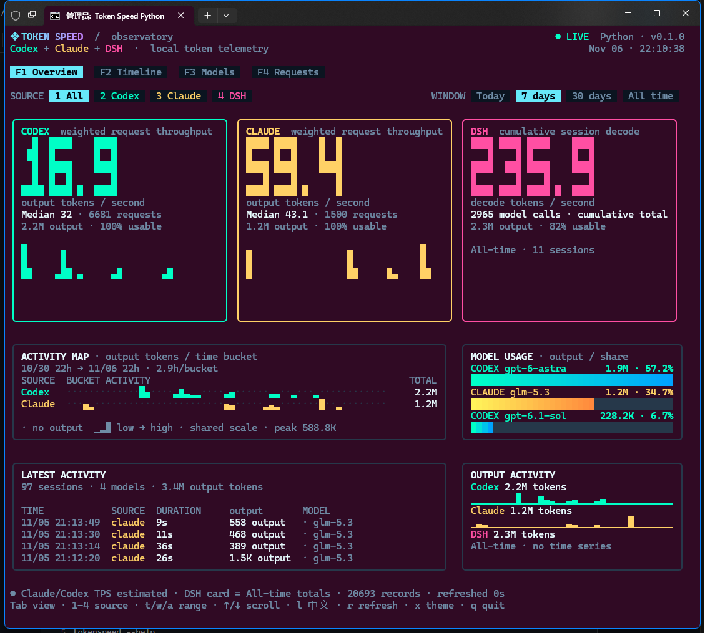
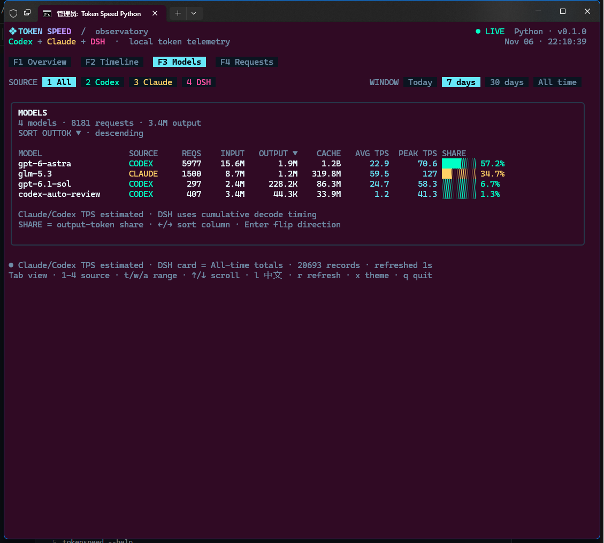

<div align="center">

# ⚡ Token Speed

**面向 Claude Code、Codex 和 DSH 的本地 Token 遥测仪。**
在终端中查看输出用量、吞吐速度和模型活动，支持完整键盘操作。

**[English](README.md) · [简体中文](README.zh-CN.md)**

[](https://github.com/Etshanyu/tokenspeed/actions/workflows/ci.yml)
[](LICENSE)
[](python/tokenspeed)
[](package.json)
[](#-快速开始)

</div>

---

## ✨ 为什么选择 Token Speed？

Token Speed 读取电脑中已有的遥测日志，将其转换为交互式终端观测台。不需要账号、API Key、后台服务，也不会上传会话数据。

| 图标 | 特性 | 说明 |
| :-: | --- | --- |
| 🔒 | **本地优先** | 只读解析日志，不主动收集提示词和源代码内容。 |
| 📊 | **四种视图** | 总览、时间线、模型和请求明细。 |
| 🧭 | **三类来源** | 自动发现 Claude Code、Codex 和 DSH。 |
| 🔄 | **实时刷新** | 后台增量扫描，减少界面卡顿和按键阻塞。 |
| 🌐 | **中英文界面** | 按 `L` 切换，自动记住界面偏好。 |
| 🎨 | **终端原生** | 实心数字、活动图、渐变色和轻量视觉动效。 |

> [!NOTE]
> Token Speed 是独立的非官方项目。Claude、Codex 和 DSH 名称归各自所有者所有。

## 🖥️ 界面截图

以下图片来自 Python 版真实终端界面，数值均来自本地遥测记录。



<details>
<summary><strong>查看模型统计界面</strong></summary>
<br>



</details>

## 🚀 快速开始

### Python 版——推荐

**环境要求：** Python 3.10 或更高版本、支持 Unicode 和真彩色的终端，建议使用 120 × 50 窗口。

#### Windows——一键启动

克隆或下载仓库后，双击：

```text
run-tokenspeed-python.bat
```

首次启动会自动创建 `.venv`，本地缓存保存在项目的 `.tokenspeed-cache` 目录。如需读取压缩的 Codex 归档，请执行：

```powershell
.venv\Scripts\python.exe -m pip install -r python\requirements.txt
```

#### Windows——手动启动

```powershell
git clone https://github.com/Etshanyu/tokenspeed.git
cd tokenspeed
py -3 -m venv .venv
.venv\Scripts\python.exe -m pip install -r python\requirements.txt
$env:PYTHONPATH = "python"
.venv\Scripts\python.exe -m tokenspeed
```

#### macOS / Linux

```bash
git clone https://github.com/Etshanyu/tokenspeed.git
cd tokenspeed
python3 -m venv .venv
.venv/bin/python -m pip install -r python/requirements.txt
PYTHONPATH=python .venv/bin/python -m tokenspeed
```

`zstandard` 为可选依赖，建议安装以读取 `.jsonl.zst` 格式的 Codex 归档。Python 版的其余功能仅使用标准库。

### Node.js 版——可选

**环境要求：** Node.js 20 或更高版本。

```bash
npm install -g tokenspeed
tokenspeed
```

也可以直接从仓库运行：

```bash
npm ci
npm start
```

Windows 用户还可以使用 `run-tokenspeed.bat`。

## 🧭 命令行参数

以下 Python 示例假设已在仓库根目录设置 `PYTHONPATH=python`。通过 npm 安装后可直接使用 `tokenspeed` 命令。

```text
python -m tokenspeed                         打开仪表盘
python -m tokenspeed --lang zh               使用中文启动
python -m tokenspeed --page models           打开指定页面
python -m tokenspeed --source claude         筛选单个来源
python -m tokenspeed --window 30d            today | 7d | 30d | all
python -m tokenspeed --theme vapor           按名称选择主题
python -m tokenspeed --home /path/to/home    指定数据根目录
python -m tokenspeed --cache-dir /path/dir   指定可写缓存目录
python -m tokenspeed --no-live               关闭自动刷新
python -m tokenspeed --rescan                忽略缓存并完整扫描
python -m tokenspeed --clear-cache           清除记录缓存后退出
python -m tokenspeed --help                  查看完整命令帮助
python -m tokenspeed --version               查看版本
```

## ⌨️ 快捷键

| 按键 | 功能 |
| --- | --- |
| `F1`–`F4` | 总览／时间线／模型／请求 |
| `Tab`、`Shift+Tab` | 下一个／上一个页面 |
| `1`–`4` | 全部／Codex／Claude／DSH |
| `t`、`w`、`a` | 今天／循环时间范围／全部时间 |
| `L` | 切换中英文 |
| `←`、`→`、`Enter` | 选择模型排序列／反转排序方向 |
| `j`、`k`、`↑`、`↓` | 滚动请求记录 |
| `g`、`G` | 顶部／底部 |
| `r` | 快速刷新变化的日志 |
| `Shift+R` | 完整重新扫描 |
| `x` | 切换主题 |
| `q`、`Ctrl+C` | 退出 |

请在真实交互式终端中使用，不要重定向输入或输出。Windows 环境推荐使用 Windows Terminal。

## 📚 数据来源

| 来源 | 相对于所选主目录的位置 | 可用历史数据 |
| --- | --- | --- |
| **Claude Code** | `.claude/projects/**/*.jsonl` | 逐响应用量与推算时长 |
| **Codex** | `.codex/sessions`、`.codex/archived_sessions` | 逐请求用量，包括 `.jsonl.zst` 归档 |
| **DSH** | `.dsh/storages/session_projcache/sessions/*.json` | 会话级累计总量 |

格式错误或仍在写入的记录会被忽略，并在文件变化后重试。Token Speed 不会修改来源日志。

## 📏 数值口径

### Claude Code 和 Codex

- **输出 TPS** = 输出 Token ÷ 推算活跃时长。
- 上游日志不一定包含精确的首 Token 和解码结束时间，因此请求吞吐速度是**估算值**。
- 卡片吞吐 = 总输出 ÷ 总推算时长；**Median** 是逐请求 TPS 的中位数。
- 模型 **PEAK TPS** 是有效逐请求速率的最近秩 p95，不是硬件基准测试结果。
- 时间窗口图表只包含请求记录。

### DSH

- DSH 提供**会话总量和累计解码时长**，不提供逐请求历史。
- DSH TPS = 全部会话输出 Token ÷ 全部解码时长。
- 有界时间窗口仍显示 DSH 总量，并明确标记为**全部累计**。
- `OUTPUT ACTIVITY` 包含 DSH 累计输出，但显示为**无时间序列**。程序不会编造时间戳或将 Token 摊入虚构时段。
- DSH 会话总量不会进入活动图、最近请求、请求表和逐请求峰值。

缓存内容与完整数据约定见 [docs/DATA.md](docs/DATA.md)。

## 🛡️ Windows SmartScreen 与未签名启动器

打开批处理启动器时，Windows 可能显示**“Windows 已保护你的电脑”**或**“未知发布者”**。这是 SmartScreen 的签名与信誉机制，不是程序运行故障。本仓库目前未附带受信任的代码签名证书。

- 只从[官方仓库](https://github.com/Etshanyu/tokenspeed)下载，检查启动脚本内容；仅在信任来源时选择**“更多信息”→“仍要运行”**。
- 如果下载文件带有 **Zone.Identifier** 来源标记，在解压前解除该文件的锁定，可能消除与下载来源有关的提示。没有此标记的文件无法通过 `Unblock-File` 获得改善。
- **不要**为了关闭提示而禁用 SmartScreen 或系统级安全检查。
- 正式的长期解决方案是使用受信任代码签名证书签署可执行文件或安装包。普通签名仍可能需要积累 SmartScreen 信誉，不能保证提示立即消失。

## 🔐 隐私与存储

Token Speed 只读取本地日志并保存派生元数据。缓存可能包含会话 ID、项目路径、模型名称、时间戳和 Token 数量，请像保护其他本地开发元数据一样保护缓存。

默认可写目录：

| 平台 | 缓存目录 |
| --- | --- |
| Windows | `%LOCALAPPDATA%\tokenspeed` |
| macOS | `~/Library/Caches/tokenspeed` |
| Linux | `${XDG_CACHE_HOME:-~/.cache}/tokenspeed` |

Windows Python 一键启动器会有意使用项目内的 `.tokenspeed-cache` 目录。`index.json` 保存派生记录，`preferences.json` 只保存界面偏好。使用 `--clear-cache` 可清除记录索引并保留偏好；删除整个目录可同时移除两者。

派生记录不会主动包含提示词、补全内容或源代码。请勿提交真实日志、缓存或未脱敏截图。

## 🛠️ 开发与验证

### Python

```bash
python -m compileall -q python/tokenspeed
PYTHONPATH=python python -m unittest discover -s python/tests -v
```

### Node.js

```bash
npm ci
npm run typecheck
npm test
npm run build
npm run bench
npm pack --dry-run
```

欢迎贡献代码。提交前请阅读 [CONTRIBUTING.md](CONTRIBUTING.md)、[SECURITY.md](SECURITY.md) 和[发布检查清单](docs/RELEASING.md)。版本状态和已知限制见 [CHANGELOG.md](CHANGELOG.md)。

## 📄 许可证

[MIT](LICENSE) © Token Speed contributors。

<div align="center">

**本地数据，清晰口径，让 Token 速度一目了然。**
[English](README.md) · [简体中文](README.zh-CN.md) · [反馈问题](https://github.com/Etshanyu/tokenspeed/issues)

</div>
